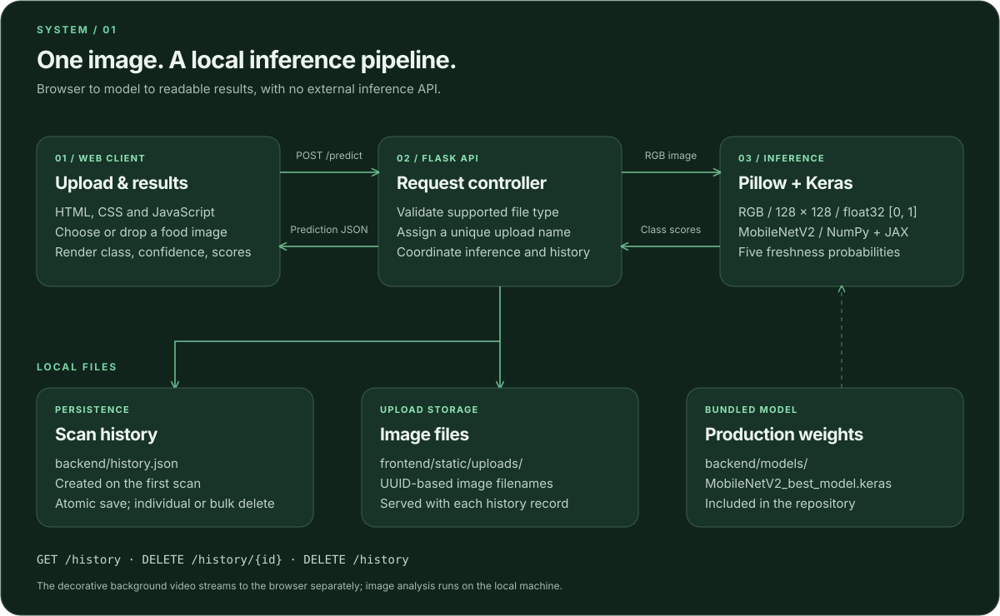

<p align="center">
  
</p>

<p align="center"><strong>Automated Produce Freshness Diagnostics via Deep Convolutional Neural Networks.</strong></p>

<p align="center">
  <a href="https://keras.io/api/applications/mobilenet/"></a>
  <a href="#benchmarks"></a>
  <a href="#architecture"></a>
  <a href="https://flask.palletsprojects.com/"></a>
  <a href="https://keras.io/"></a>
</p>

---

## Watch Veylo

https://github.com/user-attachments/assets/ca7b1de3-77ea-48e0-ad86-3341a9691965

---

## ⚡ Quick Start (Run Locally)

### 1. Install Python

Use **64-bit Python 3.12 or newer**. The clean-install check was performed with **Python 3.14 on Windows**. On Windows, select **Add Python to PATH** during installation.

### 2. Download the project

Clone this repository, or choose **Code → Download ZIP** on GitHub and extract it. Open a terminal in the extracted project folder (the folder containing this README).

### 3. Create a local environment and install dependencies

**Windows (PowerShell or Command Prompt):**

```powershell
python -m venv .venv
.\.venv\Scripts\python.exe -m pip install -r requirements.txt
.\.venv\Scripts\python.exe backend/app.py
```

**macOS / Linux:**

```bash
python3 -m venv .venv
.venv/bin/python -m pip install -r requirements.txt
.venv/bin/python backend/app.py
```

Activation is optional; these commands use the environment directly. On Linux, install your distribution's `python3-venv` package if Python reports that `venv` is unavailable. macOS/Linux commands are provided for convenience; the clean-install test was run on Windows.

### 4. Open Veylo

Open **[http://127.0.0.1:5000](http://127.0.0.1:5000)**. Keep the terminal open while using the app. Stop it with **Ctrl+C**.

Use a photo from [`Test Samples/`](Test%20Samples/) for a first scan. Upload it and wait for the prediction; the scan then appears in Scan History. Each record has its own delete button, and Clear All Records remains available.

**Included:** the actual MobileNetV2 weights at `backend/models/MobileNetV2_best_model.keras` (approximately 11.6 MB). No training, TensorFlow install, npm build, API key, account, or database setup is required. Do not exclude this model file from your GitHub upload.

**Created automatically:** `frontend/static/uploads/` and `backend/history.json`. Each new checkout starts with an empty history.

An internet connection is needed to install Python dependencies and stream the decorative background video. Image analysis runs locally; the app remains usable with its static background when the video is unavailable.

**Troubleshooting:**

- **`python` is not recognized:** reopen your terminal after installing Python with its PATH option enabled.
- **Missing module:** install requirements using the same environment's Python shown above.
- **Model file not found:** confirm that `backend/models/MobileNetV2_best_model.keras` is present in the downloaded repository.
- **Port 5000 already in use:** stop an earlier copy of the app before starting another.
- **Dependency download fails:** verify Python is 64-bit and version 3.12 or newer, then retry the installation.

---

## Project documents

The project PDFs and slide deck are available directly in the repository; download them to open locally:

- **Presentation:** [`docs/FreshSense_Presentation_Designed.pdf`](docs/FreshSense_Presentation_Designed.pdf)
- **Product requirements:** [`docs/FreshSense_PRD.pdf`](docs/FreshSense_PRD.pdf)
- **Research paper:** [`docs/Food Freshness Detection Using Machine Learning Algorithms.pdf`](docs/Food%20Freshness%20Detection%20Using%20Machine%20Learning%20Algorithms.pdf)
- **Editable slides:** [`docs/Food Freshness Detection.pptx`](docs/Food%20Freshness%20Detection.pptx)

Some archived documents retain the project's earlier FreshSense name.

---

## 🔬 The 5-Stage Freshness Spectrum

| Stage | UI Badge | Biological & Surface Indicators | Actionable Recommendation |
|:---:|:---:|---|---|
| **1** | `🟢 Fresh` | Intact cellular turgor, uniform pigmentation, zero superficial pitting or mold. | **Prime consumption.** Ideal for raw eating, salads, or extended refrigeration. |
| **2** | `🟡 Slightly Aged` | Minor water loss, slight skin gloss dullness, micro-softening at extremities. | **Safe for consumption.** Recommend use within 24–48 hours; salads or cooking. |
| **3** | `🟠 Stale` | Pronounced cellular collapse, wrinkling, moisture loss, aroma depletion. | **Culinary degradation.** Best cooked, stewed, or pureed; avoid raw salad intake. |
| **4** | `🔴 Spoiled` | Focal discoloration, early microbial mycelia, pericarp softening, off-odors. | **Unfit for consumption.** High risk of foodborne pathogens; discard immediately. |
| **5** | `🟣 Rotten` | Advanced mycotoxin colonization, structural collapse, foul decomposition gas. | **Hazardous bio-waste.** Discard into sealed organic compost or disposal. |

---

<a id="benchmarks"></a>

## 📊 Machine Learning Benchmarks & Model Selection

The classification engine was trained on a **6.41 GB curated multi-source corpus** merging three public agricultural datasets across **13 produce species**:
* **Fruits:** Apple, Banana, Mango, Orange, Strawberry
* **Vegetables:** Bell Pepper, Bitter Gourd, Capsicum, Carrot, Cucumber, Okra, Potato, Tomato

### 8-Architecture Benchmark Evaluation

Unsupervised Agglomerative Clustering was employed on image feature embeddings to derive objective biological boundaries across 8 candidate deep learning architectures:

| Neural Architecture | Parameters | K-Means F1 | Agglom Acc | Agglom Macro F1 | Production Suitability |
|---|:---:|:---:|:---:|:---:|---|
| **AlexNet** | 60.0M | 0.70 | 0.84 | 0.83 | ⚠️ Weights stored as 134-byte Git LFS stub |
| **MobileNetV2 (Selected)** | **3.4M** | **0.75** | **0.82** | **0.82** | ✅ **Production Champion (11.5 MB binary, &lt;850ms CPU)** |
| **DenseNet121** | 8.0M | 0.74 | 0.83 | 0.82 | 2.4x larger parameter footprint |
| **Xception** | 22.8M | 0.70 | 0.81 | 0.80 | High memory consumption on edge CPU |
| **InceptionV3** | 23.8M | 0.72 | 0.74 | 0.73 | Sub-optimal F1 performance |
| **VGG16 / VGG19** | 138M–143M | 0.65 | 0.68 | 0.55 | Severe parameter bloat, poor generalization |
| **ResNet50** | 25.6M | 0.23 | 0.42 | 0.34 | Underperformed on subtle transitional textures |

> **Why MobileNetV2?** MobileNetV2 matches the macro F1 precision of DenseNet121 while requiring over **10x fewer parameters** than AlexNet/VGG. Inverted residual blocks with linear bottlenecks allow instantaneous cold start (&lt;3.5s) and thread-safe CPU execution.

---

<a id="architecture"></a>

## 🏗 System Architecture & Data Pipeline



### Key Engineering Decisions
1. **Windows CRT Resilience (`Errno 22` Patch):** Model inference executes strictly with `verbose=0`, preventing Keras Progbar escape sequences from crashing non-interactive Windows C-runtime stdout handles.
2. **Deterministic Preprocessing:** Images are converted to 3-channel RGB, bicubic interpolated to `128 × 128`, normalized to `float32` in `[0.0, 1.0]`, and packaged with batch dimension `(1, 128, 128, 3)`.
3. **Zero-Framework Client:** The frontend uses pure semantic HTML5, CSS custom properties, and vanilla ES6 JavaScript—achieving sub-100ms load times with zero npm dependencies.

---

## 📂 Repository Layout

```text
Veylo-AI-Project/
├── frontend/
│   ├── index.html
│   └── static/
│       ├── brand/           # SVG logo, favicon, icon license
│       ├── css/style.css
│       ├── fonts/           # Self-hosted fonts and their licenses
│       ├── js/app.js
│       └── uploads/         # Generated locally; excluded from Git
├── backend/
│   ├── app.py
│   ├── requirements.txt    # Runtime dependency versions
│   ├── history.json        # Generated locally; excluded from Git
│   └── models/
│       └── MobileNetV2_best_model.keras  # Required; included
├── docs/                   # PDFs and editable presentation
├── Test Samples/           # Small set of demo images
├── Food-Freshness AI Model/ # Research notebooks and evaluation outputs
├── brag.mp4                # Project demo video
├── requirements.txt        # Uses backend/requirements.txt
└── README.md
```

---

## Deliverables

| Deliverable | Location |
|---|---|
| Local web application | `http://127.0.0.1:5000` after starting the backend |
| Presentation PDF | [`docs/FreshSense_Presentation_Designed.pdf`](docs/FreshSense_Presentation_Designed.pdf) |
| Product requirements PDF | [`docs/FreshSense_PRD.pdf`](docs/FreshSense_PRD.pdf) |
| Editable presentation | [`docs/Food Freshness Detection.pptx`](docs/Food%20Freshness%20Detection.pptx) |
| Research paper | [`docs/Food Freshness Detection Using Machine Learning Algorithms.pdf`](docs/Food%20Freshness%20Detection%20Using%20Machine%20Learning%20Algorithms.pdf) |

---

<div align="center">
  <sub>Veylo • Automated Produce Diagnostics via Computer Vision • September 2026</sub>
</div>
