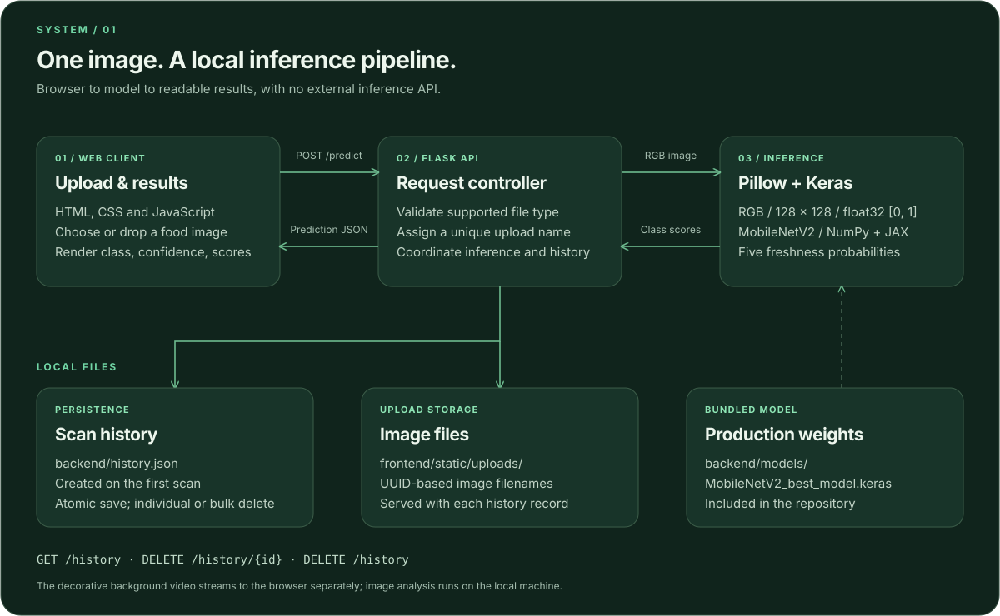

<p align="center">
  
</p>

<p align="center"><strong>Automated Produce Freshness Diagnostics via Deep Convolutional Neural Networks.</strong></p>

<p align="center">
  <a href="https://www.python.org/"></a>
  &nbsp;
  <a href="https://flask.palletsprojects.com/"></a>
  &nbsp;
  <a href="https://keras.io/"></a>
  &nbsp;
  <a href="https://numpy.org/"></a>
  &nbsp;
  <a href="https://www.tensorflow.org/api_docs/python/tf/keras/applications/MobileNetV2"></a>
</p>

<p align="center">
  <a href="#features">Features</a> &nbsp;·&nbsp;
  <a href="#quick-start">Quick Start</a> &nbsp;·&nbsp;
  <a href="#freshness-scale">Freshness Scale</a> &nbsp;·&nbsp;
  <a href="#benchmarks">Benchmarks</a> &nbsp;·&nbsp;
  <a href="#architecture">Architecture</a> &nbsp;·&nbsp;
  <a href="#techstack">TechStack</a> &nbsp;·&nbsp;
  <a href="#api-endpoints">API</a>
</p>

<br>

<p align="center">
  <picture>
    <source media="(prefers-color-scheme: dark)" srcset="docs/assets/section-divider-dark.svg">
    <source media="(prefers-color-scheme: light)" srcset="docs/assets/section-divider-light.svg">
    
  </picture>
</p>

## 🎬 Watch Veylo

https://github.com/user-attachments/assets/ca7b1de3-77ea-48e0-ad86-3341a9691965

<br>

<p align="center">
  <a id="features"></a>
  <picture>
    <source media="(prefers-color-scheme: dark)" srcset="docs/assets/section-divider-dark.svg">
    <source media="(prefers-color-scheme: light)" srcset="docs/assets/section-divider-light.svg">
    
  </picture>
</p>

## ✨ Features

- **Drag-and-drop produce analysis:** Upload `.jpg`, `.jpeg`, `.png`, or `.webp` food photos for local MobileNetV2 inference (`<850ms` on CPU).
- **Five-stage quality breakdown:** Returns the predicted freshness class, top confidence percentage, guidance text, and probability scores across all 5 stages.
- **Local scan history:** Automatically saves predictions to `backend/history.json` with image previews, single-record deletion, and one-click clear all.
- **Zero-dependency web UI:** Adaptive light/dark theme toggle, responsive layout, and reduced-motion support without Node.js or database setup.

<br>

<p align="center">
  <a id="quick-start"></a>
  <picture>
    <source media="(prefers-color-scheme: dark)" srcset="docs/assets/section-divider-dark.svg">
    <source media="(prefers-color-scheme: light)" srcset="docs/assets/section-divider-light.svg">
    
  </picture>
</p>

## ⚡ Quick Start

**Prerequisite:** 64-bit **Python 3.12+** (tested on Python 3.14 Windows). The trained model (`backend/models/MobileNetV2_best_model.keras`) is bundled—no TensorFlow setup, Node build, API key, or external DB is needed.

**Windows (PowerShell):**
```powershell
python -m venv .venv
.\.venv\Scripts\python.exe -m pip install -r requirements.txt
.\.venv\Scripts\python.exe backend/app.py
```

**macOS / Linux:**
```bash
python3 -m venv .venv
.venv/bin/python -m pip install -r requirements.txt
.venv/bin/python backend/app.py
```

Open **[http://127.0.0.1:5000](http://127.0.0.1:5000)** and try any image from [`Test Samples/`](Test%20Samples/). `frontend/static/uploads/` and `backend/history.json` are created automatically on first run.

<br>

<p align="center">
  <a id="freshness-scale"></a>
  <picture>
    <source media="(prefers-color-scheme: dark)" srcset="docs/assets/section-divider-dark.svg">
    <source media="(prefers-color-scheme: light)" srcset="docs/assets/section-divider-light.svg">
    
  </picture>
</p>

## 🔬 The 5-Stage Freshness Spectrum

| Stage | Label | Visual Indicators | Recommendation |
|:---:|:---:|---|---|
| **1** | `🟢 Fresh` | Firm texture, uniform color, no blemishes or mold. | Safe to consume fresh or store refrigerated. |
| **2** | `🟡 Slightly Aged` | Minor moisture loss, slight dullness or soft spots. | Safe to eat; best used within 24–48 hours. |
| **3** | `🟠 Stale` | Visible wrinkling, softening, and color fading. | Declining quality; best cooked or inspected closely. |
| **4** | `🔴 Spoiled` | Dark spots, early mold growth, noticeable decay. | Not recommended for consumption; discard. |
| **5** | `🟣 Rotten` | Severe breakdown, heavy mold, structural collapse. | Discard immediately. |

<br>

<p align="center">
  <a id="benchmarks"></a>
  <picture>
    <source media="(prefers-color-scheme: dark)" srcset="docs/assets/section-divider-dark.svg">
    <source media="(prefers-color-scheme: light)" srcset="docs/assets/section-divider-light.svg">
    
  </picture>
</p>

## 📊 Machine Learning Benchmarks

Trained on a **6.41 GB multi-source dataset** spanning **13 produce species** (5 fruits: Apple, Banana, Mango, Orange, Strawberry; 8 vegetables: Bell Pepper, Bitter Gourd, Capsicum, Carrot, Cucumber, Okra, Potato, Tomato) using Agglomerative Clustering & K-Means feature boundaries across 8 CNNs:

| Architecture | Parameters | K-Means F1 | Agglom Acc | Agglom Macro F1 | Summary |
|---|:---:|:---:|:---:|:---:|---|
| **MobileNetV2 (Selected)** | **3.4M** | **0.75** | **0.82** | **0.82** | ✅ **Selected — 11.5 MB weights, &lt;850ms CPU inference** |
| **DenseNet121** | 8.0M | 0.74 | 0.83 | 0.82 | Similar accuracy with 2.4× more parameters |
| **AlexNet** | 60.0M | 0.70 | 0.84 | 0.83 | Heavyweight architecture (60M parameters) |
| **Xception** | 22.8M | 0.70 | 0.81 | 0.80 | Higher CPU memory footprint |
| **InceptionV3** | 23.8M | 0.72 | 0.74 | 0.73 | Lower F1 score |
| **VGG16 / VGG19** | 138M–143M | 0.65 | 0.68 | 0.55 | Excessive model size & weak generalization |
| **ResNet50** | 25.6M | 0.23 | 0.42 | 0.34 | Underperformed on transitional freshness stages |

> **Why MobileNetV2?** It matches DenseNet121's macro F1 (`0.82`) with **10× fewer parameters** than AlexNet/VGG, giving fast cold start (`<3.5s`) and lightweight local CPU inference.

<br>

<p align="center">
  <a id="architecture"></a>
  <picture>
    <source media="(prefers-color-scheme: dark)" srcset="docs/assets/section-divider-dark.svg">
    <source media="(prefers-color-scheme: light)" srcset="docs/assets/section-divider-light.svg">
    
  </picture>
</p>

## 🏗 System Architecture



- **Deterministic preprocessing:** Images convert to 3-channel RGB, resize to `128 × 128`, normalize to `float32` `[0.0, 1.0]`, and run with `verbose=0` for clean cross-platform execution.
- **Local persistence:** Atomic writes (`tempfile` + `os.replace`) keep `backend/history.json` corruption-free while managing uploaded assets under `frontend/static/uploads/`.

<br>

<p align="center">
  <a id="techstack"></a>
  <picture>
    <source media="(prefers-color-scheme: dark)" srcset="docs/assets/section-divider-dark.svg">
    <source media="(prefers-color-scheme: light)" srcset="docs/assets/section-divider-light.svg">
    
  </picture>
</p>

## 🧱 TechStack

| Layer | Technologies |
| :--- | :--- |
| **Frontend** | <a href="https://developer.mozilla.org/en-US/docs/Web/HTML">&nbsp;HTML5</a> &nbsp;·&nbsp; <a href="https://developer.mozilla.org/en-US/docs/Web/CSS">&nbsp;CSS3</a> &nbsp;·&nbsp; <a href="https://developer.mozilla.org/en-US/docs/Web/JavaScript">&nbsp;JavaScript (ES6)</a> |
| **Backend & API** | <a href="https://www.python.org/">&nbsp;Python 3.12+</a> &nbsp;·&nbsp; <a href="https://flask.palletsprojects.com/">&nbsp;Flask 3.1</a> |
| **Inference & Imaging** | <a href="https://keras.io/">&nbsp;Keras 3</a> &nbsp;·&nbsp; <a href="https://www.tensorflow.org/api_docs/python/tf/keras/applications/MobileNetV2">&nbsp;MobileNetV2</a> &nbsp;·&nbsp; <a href="https://numpy.org/">&nbsp;NumPy</a> &nbsp;·&nbsp; <a href="https://python-pillow.org/">&nbsp;Pillow</a> &nbsp;·&nbsp; <a href="https://scipy.org/">&nbsp;SciPy</a> &nbsp;·&nbsp; <a href="https://jax.readthedocs.io/">&nbsp;JAX</a> |
| **Training & Research** | <a href="https://www.tensorflow.org/">&nbsp;TensorFlow</a> &nbsp;·&nbsp; <a href="https://scikit-learn.org/">&nbsp;scikit-learn</a> &nbsp;·&nbsp; <a href="https://opencv.org/">&nbsp;OpenCV</a> &nbsp;·&nbsp; <a href="https://pandas.pydata.org/">&nbsp;Pandas</a> &nbsp;·&nbsp; <a href="https://matplotlib.org/">&nbsp;Matplotlib</a> |
| **Storage** | <a href="https://www.json.org/">&nbsp;Local JSON (`history.json`)</a> |

<br>

<p align="center">
  <a id="api-endpoints"></a>
  <picture>
    <source media="(prefers-color-scheme: dark)" srcset="docs/assets/section-divider-dark.svg">
    <source media="(prefers-color-scheme: light)" srcset="docs/assets/section-divider-light.svg">
    
  </picture>
</p>

## 🔌 API Endpoints

| Method | Endpoint | Purpose |
| :--- | :--- | :--- |
| `GET` | `/` | Serves the web UI (`frontend/index.html`) |
| `POST` | `/predict` | Accepts `multipart/form-data` (`file`: `.jpg`, `.jpeg`, `.png`, `.webp`) and returns prediction, confidence, and 5-class probabilities |
| `GET` | `/history` | Returns saved scan records from `backend/history.json` |
| `DELETE` | `/history/<record_id>` | Deletes a single scan record and removes its orphaned upload |
| `DELETE` | `/history` | Clears all scan history and uploaded files |

<br>

<p align="center">
  <picture>
    <source media="(prefers-color-scheme: dark)" srcset="docs/assets/section-divider-dark.svg">
    <source media="(prefers-color-scheme: light)" srcset="docs/assets/section-divider-light.svg">
    
  </picture>
</p>

## 📂 Repository Layout

```text
Veylo-AI-Project/
├── frontend/                  # Static UI (HTML, CSS, JS, brand assets & fonts)
├── backend/
│   ├── app.py                 # Flask server & inference pipeline
│   ├── requirements.txt       # Runtime dependencies
│   └── models/
│       └── MobileNetV2_best_model.keras
├── docs/                      # Research paper, PRD, presentations & README SVGs
├── Test Samples/              # Sample produce images
├── Food-Freshness AI Model/   # Training notebooks, plots & confusion matrices
└── requirements.txt           # Points to backend/requirements.txt
```

<br>

<p align="center">
  <picture>
    <source media="(prefers-color-scheme: dark)" srcset="docs/assets/section-divider-dark.svg">
    <source media="(prefers-color-scheme: light)" srcset="docs/assets/section-divider-light.svg">
    
  </picture>
</p>

## 📄 Research & Documentation

| Document | File |
|---|---|
| Research Paper | [`docs/Food Freshness Detection Using Machine Learning Algorithms.pdf`](docs/Food%20Freshness%20Detection%20Using%20Machine%20Learning%20Algorithms.pdf) |
| Product Requirements (PRD) | [`docs/FreshSense_PRD.pdf`](docs/FreshSense_PRD.pdf) |
| Presentation (PDF) | [`docs/FreshSense_Presentation_Designed.pdf`](docs/FreshSense_Presentation_Designed.pdf) |
| Presentation (Editable) | [`docs/Food Freshness Detection.pptx`](docs/Food%20Freshness%20Detection.pptx) |

<br>

<p align="center">
  <picture>
    <source media="(prefers-color-scheme: dark)" srcset="docs/assets/section-divider-dark.svg">
    <source media="(prefers-color-scheme: light)" srcset="docs/assets/section-divider-light.svg">
    
  </picture>
</p>

## 🛠️ Troubleshooting & Scope

| Issue | Fix |
|---|---|
| `python` not found | Install 64-bit Python 3.12+ with **Add Python to PATH** and reopen your terminal. |
| Missing module | Install dependencies using the `.venv` Python binary shown in Quick Start. |
| Model file not found | Ensure `backend/models/MobileNetV2_best_model.keras` is present. |
| Port `5000` busy | Stop the previous Flask instance before launching again. |

> ⚠️ **Scope:** Predictions are trained on 13 specific produce species and intended for academic demonstration—always inspect food visually before consumption.

<br>

<p align="center">
  <picture>
    <source media="(prefers-color-scheme: dark)" srcset="docs/assets/section-divider-dark.svg">
    <source media="(prefers-color-scheme: light)" srcset="docs/assets/section-divider-light.svg">
    
  </picture>
</p>

<div align="center">
  <sub>Veylo • Automated Produce Diagnostics via Computer Vision • September 2026</sub>
</div>
